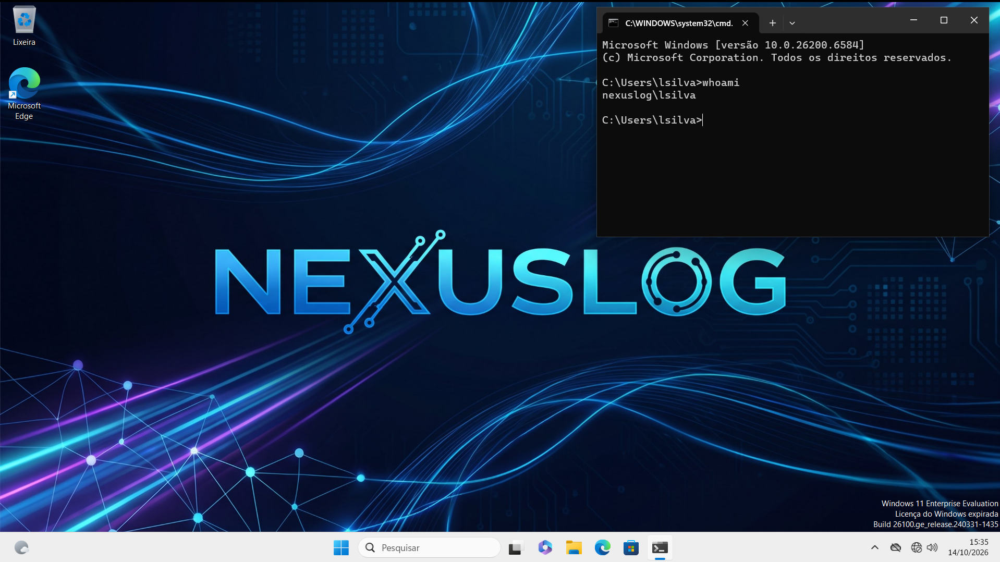
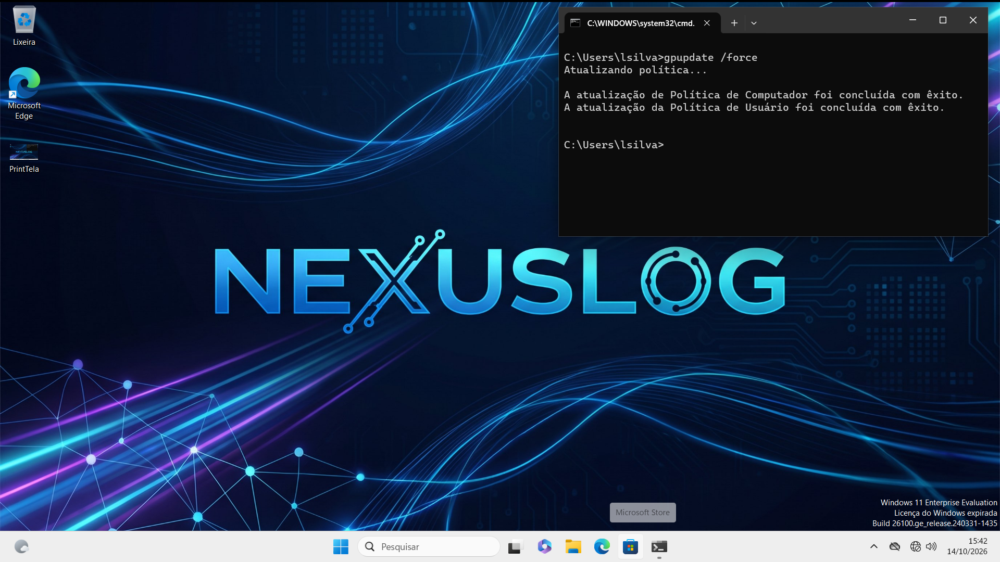
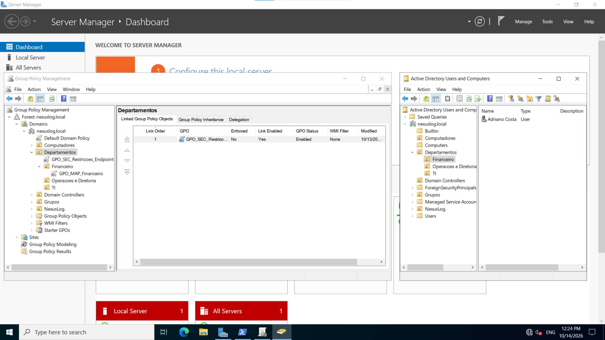

# NexusLab: Padronização de Endpoints e Governança com Active Directory & GPO

## 1. Visão Geral
Laboratório prático simulando a infraestrutura corporativa da empresa fictícia **NexusLog**. O projeto aborda a implantação de um domínio Active Directory no Windows Server, governança de identidade e acesso, isolamento de rede virtual no Hyper-V e distribuição automatizada de políticas de grupo (GPOs) com foco em conformidade e padronização visual.

---

## 2. Topologia & Configurações de Rede

| Atributo | Controlador de Domínio (`DC01`) | Estação de Trabalho (`WS01`) |
| :--- | :--- | :--- |
| **Sistema Operacional** | Windows Server | Windows 11 Enterprise |
| **Função** | AD DS, DNS, DHCP | Endpoint corporativo |
| **Domínio / FQDN** | `nexuslog.local` | Ingressada em `nexuslog.local` |
| **Endereço IPv4** | `192.168.100.10/24` | `192.168.100.50/24` |
| **Servidor DNS** | `127.0.0.1` | `192.168.100.10` |
| **Hipervisor** | Hyper-V (Switch Interno: `vSwitch-NexusLab`) | Hyper-V (Switch Interno: `vSwitch-NexusLab`) |

---

## 3. Implementação Técnica

### 3.1. Governança e Compartilhamento de Recursos
* **Unidades Organizacionais (OUs):** Estruturação departamental para segregação de contas e computadores.
* **Compartilhamento Oculto:** Criação do compartilhamento administrativo `\\DC01.nexuslog.local\Dados$\Geral` com permissões NTFS de leitura estritas ao grupo `Domain Users`.
* **Transporte de Ativos:** Cópia dos ativos visuais institucionais para o controlador de domínio via montagem de disco virtual temporário (VHD).

### 3.2. Políticas de Grupo (GPO)
* **Prevenção de Alteração do Fundo:**
  * Caminho: `User Configuration > Policies > Administrative Templates > Control Panel > Personalization`
  * Diretiva: `Prevent changing desktop background` $\rightarrow$ **Enabled**.
* **Distribuição do Arquivo via GPP (Group Policy Preferences):**
  * Caminho: `Computer Configuration > Preferences > Windows Settings > Files`
  * Ação: Cópia mandatória do arquivo de rede para o disco local em `C:\Windows\Web\Wallpaper\TempLab-NEXUSLOG.jpg` (mitigando latências de rede no logon).
* **Papel de Parede Corporativo:**
  * Caminho: `User Configuration > Policies > Administrative Templates > Desktop > Desktop`
  * Diretiva: `Desktop Wallpaper` $\rightarrow$ **Enabled** (apontando para o caminho local `C:\Windows\Web\Wallpaper\TempLab-NEXUSLOG.jpg`).

---

## 4. Troubleshooting & Resolução de Falhas

### Reversão para IP APIPA (`169.254.x.x`)
Após modificações no switch virtual, a interface descartava a configuração temporária de GUI. O problema foi sanado com a persistência de IP e DNS a nível de sistema operacional via PowerShell:

```powershell
New-NetIPAddress -InterfaceAlias "Ethernet" -IPAddress 192.168.100.10 -PrefixLength 24
Set-DnsClientServerAddress -InterfaceAlias "Ethernet" -ServerAddresses 127.0.0.1, 192.168.100.10
```
### Resolução de Domínio e Conectividade GPO
Correção do apontamento de DNS primário na estação cliente `WS01` para o IP do DC (`192.168.100.10`), eliminando a falha de descoberta de domínio durante a execução do comando `gpupdate /force`.

### Sintoma da "Tela Preta" no Windows 11
O subsistema de interface gráfica carregava antes da negociação completa da pilha SMB de rede no logon, gerando falha de leitura e corrompendo o cache local de temas (`TranscodedWallpaper`).

A correção foi estruturada apontando a GPO para o arquivo local entregue via GPP e redefinindo os parâmetros no registro da sessão do usuário:

```cmd
reg add "HKCU\Control Panel\Desktop" /v Wallpaper /t REG_SZ /d "C:\Windows\Web\Wallpaper\TempLab-NEXUSLOG.jpg" /f
reg add "HKCU\Control Panel\Desktop" /v WallpaperStyle /t REG_SZ /d "2" /f
del /f /q "%APPDATA%\Microsoft\Windows\Themes\TranscodedWallpaper"
taskkill /f /im explorer.exe && start explorer.exe
```
## 5. Validação dos Resultados
* **Conectividade:** Resolução bidirecional com latência `<1ms` entre cliente e controlador de domínio.
* **Políticas de Grupo:** Execução bem-sucedida de `gpupdate /force` tanto nas diretivas de computador quanto nas de usuário.
* **Segurança e Conformidade:** Papel de parede institucional fixado no logon e configurações de personalização travadas para o usuário final.

---

## 6. Evidências do Projeto

### 01. Identidade Visual Aplicada no Endpoint
Validação da Área de Trabalho na estação `WS01` com a conta de usuário corporativo autenticada no domínio.



---

### 02. Atualização e Aplicação de GPO com Êxito
Execução do `gpupdate /force` confirmando a aplicação integral das políticas de computador e usuário.



---

### 03. Gerenciamento de Diretivas e Estrutura no DC01
Visão consolidada do console do Active Directory (OUs) e do Group Policy Management Console (GPMC).


